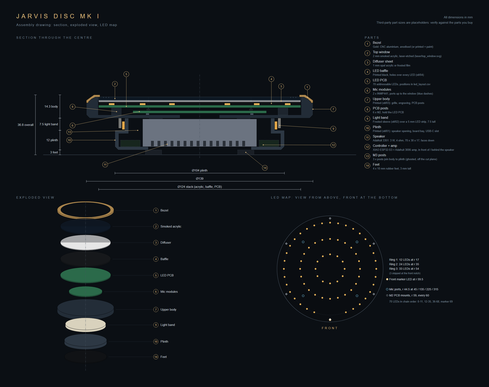

# Jarvis Disc — Technical Assembly Drawing

## What this is

The Mk I assembly drawing for the **Jarvis Disc** — section view, exploded view, and the
LED map of the device, rendered from the vector master.

- `jarvis-disc-technical.svg` — editable 2400×1900 master drawing
- `jarvis-disc-technical.png` — raster render of the same

It documents the physical stack of the disc: smoked acrylic top, gold bezel, the 70-LED
main ring on the PCB plus the 17-LED seam strip, microphone ports for the twin INMP441
modules, the MAX98357A amplifier and 4Ω speaker, the ESP32-S3 (XIAO) controller board,
the physical microphone mute switch, and USB-C power entry.

## Why it exists

Jarvis's intelligence lives on a central Ubuntu server (models, memory, orchestration).
The disc is its **house-placed interaction endpoint** — one per room, all identical, all
dumb terminals that stream audio and render light. Before any board gets ordered, the
mechanical and electronic form of that endpoint has to be nailed down: what fits inside
the envelope, where the mics face, how the LED ring illuminates through smoked acrylic,
where the mute switch breaks the mic line in hardware, and how the speaker loads against
the enclosure.

This drawing is that fixed point. It is the reference for enclosure fabrication, PCB
placement, and firmware LED indexing — the LED map in particular defines the numbering
the animation engine must follow so that "listening" looks the same on every disc in the
house.

## Status

Design reference only — this repo contains drawings, not build files, firmware, or a
bill of materials. Hardware validation is a later phase of the Jarvis project.
